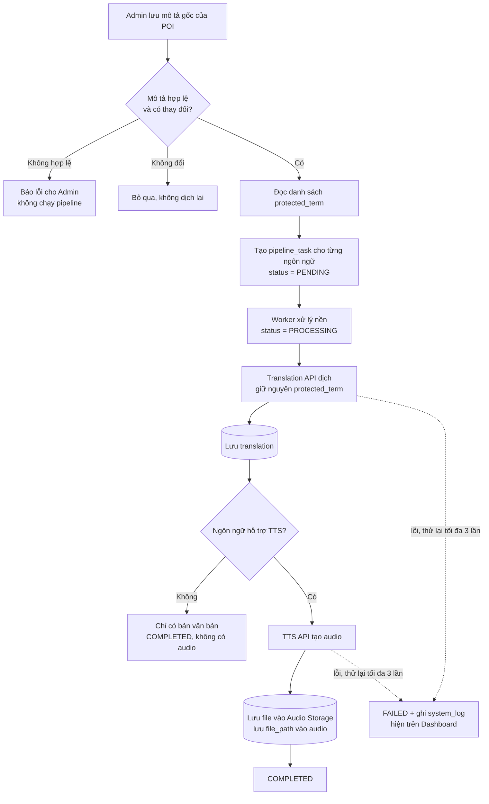
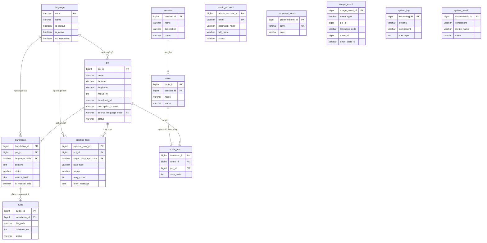
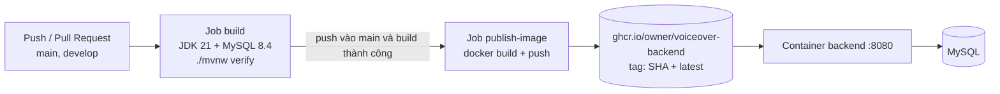

# VoiceMap — Backend

> UC02 GPS 23/10/2026: xem [yêu cầu, cách dùng và bằng chứng kiểm tra](./UC02_GPS_IMPLEMENTATION.md). Nghe thủ công đã có; bản mới nối tự phát GPS với bộ phát chung. Backend đã restart, kiểm API ghi lượt nghe trên MySQL và dữ liệu Session/Route sau restart đã qua; nghiệm thu GPS/audio trên thiết bị thực còn được ghi riêng.

> Cập nhật Session & Routes 23/10/2026: xem [phạm vi đã duyệt, API, migration và kiểm chứng](./SESSION_ROUTES_REQUIREMENTS.md). Admin mở `/admin/sessions`; khách xem và bắt đầu Route thuộc UC04, tùy chỉnh thuộc UC03. Các ghi chú skeleton/tiến độ cũ bên dưới chưa phản ánh toàn bộ working tree.

> Hệ thống ứng dụng **thuyết minh tự động đa ngôn ngữ** (Multilingual Auto-Tour Guide System).
> Backend phục vụ ứng dụng di động của du khách, Admin Portal và Monitoring Dashboard.

Đồ án môn **Công nghệ phần mềm** — Nhóm 2 — GVHD: Nguyễn Quốc Huy.


> [!NOTE]
> **Trạng thái hiện tại:** repository đang ở giai đoạn khởi tạo nền tảng — đã có skeleton Spring Boot, schema cơ sở dữ liệu (Flyway V1–V4), Dockerfile và CI/CD.
> Các lớp `controllers`, `services`, `repositories`, `entities` đã được tạo thư mục nhưng **chưa có mã nghiệp vụ**. Xem [Tiến độ](#12-tiến-độ-triển-khai).

---

## Mục lục

1. [Giới thiệu](#1-giới-thiệu)
2. [Tính năng](#2-tính-năng)
3. [Kiến trúc hệ thống](#3-kiến-trúc-hệ-thống)
4. [Công nghệ sử dụng](#4-công-nghệ-sử-dụng)
5. [Cấu trúc thư mục](#5-cấu-trúc-thư-mục)
6. [Mô hình dữ liệu](#6-mô-hình-dữ-liệu)
7. [Bắt đầu nhanh](#7-bắt-đầu-nhanh)
8. [Cấu hình](#8-cấu-hình)
9. [Docker](#9-docker)
10. [CI/CD và triển khai](#10-cicd-và-triển-khai)
11. [Use case và quy tắc nghiệp vụ chính](#11-use-case-và-quy-tắc-nghiệp-vụ-chính)
12. [Tiến độ triển khai](#12-tiến-độ-triển-khai)
13. [Tài liệu liên quan](#13-tài-liệu-liên-quan)
14. [Nhóm thực hiện](#14-nhóm-thực-hiện)

---

## 1. Giới thiệu

VoiceMap được thiết kế theo mô hình **hai lớp người dùng**:

| Đối tượng | Giao diện | Mục tiêu |
|---|---|---|
| **Du khách** | Mobile App (React Native) | Định vị GPS, xem POI lân cận, nghe thuyết minh tự động bằng 15+ ngôn ngữ, đi theo lộ trình gợi ý. **Không cần đăng ký tài khoản.** |
| **Quản trị viên / Nhân viên** | Admin Portal (React.js) + Monitoring Dashboard | Quản lý POI, session, lộ trình; theo dõi pipeline dịch/TTS; giám sát hệ thống và số liệu sử dụng gần thời gian thực. |

**Giá trị cốt lõi:** khi nhân viên lưu mô tả gốc của một POI, hệ thống tự động **dịch sang hơn 15 ngôn ngữ** và **tổng hợp giọng nói (TTS)** cho từng ngôn ngữ; du khách chỉ cần chạm vào POI hoặc đi vào vùng kích hoạt là nghe được thuyết minh ngay tại chỗ.

Repository này là **backend** của hệ thống (REST API, pipeline dịch & TTS, lưu trữ dữ liệu, giám sát).

---

## 2. Tính năng

Theo PRD v1.0 (20/09/2026):

| Mã | Tính năng | Mô tả ngắn |
|---|---|---|
| F-01 / FR-1 | Định vị GPS & POI lân cận | Trả về POI đã xuất bản trong bán kính 500 m kèm khoảng cách; hỗ trợ tự phát audio khi vào vùng kích hoạt của POI. |
| F-02 / FR-2 | Lộ trình & chỉ đường | Lộ trình gợi ý (2–10 POI) thuộc một Session; người dùng thêm/bớt/sắp xếp lại; đường đi bộ qua Directions API. |
| F-03 / FR-3 | Pipeline dịch & TTS | Tác vụ nền theo từng ngôn ngữ: áp dụng `protected_term` → dịch → TTS → lưu audio; tự thử lại tối đa 3 lần. |
| F-04 / FR-4 | CSDL POI tích hợp | Lưu toạ độ, bán kính, thumbnail, mô tả, bản dịch; file audio lưu ở kho file, CSDL chỉ giữ đường dẫn. |
| F-05 / FR-5, FR-7 | Admin Portal | Đăng nhập; CRUD POI; xem trạng thái pipeline, nghe thử/sửa bản dịch; quản lý Session/Route; **AI gợi ý mô tả** (chỉ là bản nháp). |
| F-06 / FR-6 | Monitoring Dashboard | Trạng thái app/DB/pipeline (xanh–vàng–đỏ), tỷ lệ lỗi, độ trễ API, người dùng đang hoạt động, lượt nghe theo POI/ngôn ngữ, lộ trình phổ biến. |

---

## 3. Kiến trúc hệ thống

Backend theo **kiến trúc 3 lớp** (Controller → Service → Repository), đóng gói bằng Docker.


### Các thành phần

| Thành phần | Vai trò |
|---|---|
| **Client** (Mobile App) | App Controller, GUI Map, GPS Tracker, Audio Player, Itinerary View, Language Selector. Gọi **REST API**. |
| **Admin Portal** | POI Content Editor (có AI gợi ý), Session Manager, Route Manager, Translation & Audio Review, Login. Gọi **Admin API**. |
| **Dashboard** | Usage Panel, Status Panel, Error List, Login. Gọi **Monitoring API**. |
| **SERVER** | Public API Controller, Admin API Controller, AuthService, Narration Service, Itinerary Service, Admin/Content Service và các Repository (POI, Translation/Audio, Itinerary/Session, Account). |
| **Translation & TTS Pipeline Worker** | Xử lý nền việc dịch và tạo audio; ghi bản dịch/audio về Repository và báo trạng thái/lỗi cho Monitoring. |
| **Monitoring Server** | Monitoring API Controller, Monitoring Service, Usage Event / System Log Repository; xác thực Admin thông qua AuthService. |
| **Database** | Relational Database (metadata), Audio File Storage (file `.mp3`), Log & Metrics Store. |
| **External Services** | AI Content API, Translation API, TTS API, Directions API. |

### Luồng pipeline dịch và tạo audio (F-03 / UC08)



---

## 4. Công nghệ sử dụng

| Nhóm | Công nghệ | Ghi chú |
|---|---|---|
| Ngôn ngữ | Java **21** | |
| Framework | Spring Boot **4.1.1** | `spring-boot-starter-webmvc`, `spring-boot-starter-data-jpa` |
| CSDL | MySQL **8.x** (CI dùng 8.4) | Driver `mysql-connector-j` |
| Migration | Flyway | `spring-boot-starter-flyway`, `flyway-mysql` |
| ORM | Hibernate / JPA | `ddl-auto=validate` (schema do Flyway quản lý), `open-in-view=false`, múi giờ UTC |
| Tiện ích | Lombok | |
| Build | Maven Wrapper (Maven 3.9.16) | Không cần cài Maven |
| Container | Docker (multi-stage) | Build: `maven:3.9-eclipse-temurin-21`; Run: `eclipse-temurin:21-jre` |
| CI/CD | GitHub Actions + GHCR | |

**Dự kiến tích hợp (theo PRD, chưa có trong code):** dịch vụ Translation, TTS, AI sinh mô tả, Directions API; kho lưu file audio (Object Storage); xác thực Admin; Mobile App (React Native) và Admin Portal/Dashboard (React.js).

---

## 5. Cấu trúc thư mục

```text
voiceover-backend/
├── .github/workflows/maven.yml        # CI: test + build + publish image
├── .mvn/wrapper/                      # Maven Wrapper
├── docs/images/                       # Sơ đồ ERD, component diagram
├── src/
│   ├── main/
│   │   ├── java/com/voiceover/backend/
│   │   │   ├── VoiceoverBackendApplication.java
│   │   │   ├── config/                # Cấu hình (chưa có code)
│   │   │   ├── controllers/           # Lớp Controller (chưa có code)
│   │   │   ├── dtos/                  # DTO (chưa có code)
│   │   │   ├── entities/              # JPA entities (chưa có code)
│   │   │   ├── repositories/          # Repository (chưa có code)
│   │   │   └── services/              # Service (chưa có code)
│   │   └── resources/
│   │       ├── application.properties
│   │       └── db/migration/          # Flyway: V1 → V4
│   └── test/java/com/voiceover/backend/
│       └── VoiceoverBackendApplicationTests.java
├── Dockerfile
├── mvnw / mvnw.cmd
└── pom.xml
```

---

## 6. Mô hình dữ liệu

Schema được quản lý bằng **Flyway** (`src/main/resources/db/migration`). Hibernate chỉ `validate`, không tự tạo/sửa bảng.




### Migration

| File | Nội dung |
|---|---|
| `V1__core_schema.sql` | `language`, `AdminAccount`, `poi`, `translation`, `audio`, `pipeline_task` |
| `V2__session_route.sql` | `session`, `route`, `route_stop` |
| `V3__monitoring_and_terms.sql` | `usage_event`, `system_log`, `system_metric`, `protected_term` |
| `V4__seed_languages.sql` | Seed **16 ngôn ngữ**, mặc định `vi` |

### Ghi chú về mô hình

- **Ngôn ngữ:** 16 ngôn ngữ được seed, trong đó 14 hỗ trợ TTS; `ms` và `hi` chỉ có bản văn bản (`tts_supported = FALSE`). Chỉ **một** ngôn ngữ được đặt `is_default` (ràng buộc bằng generated column `default_marker` + unique key).
- **Bản dịch / Audio:** `translation` unique theo `(poi_id, language_code)`; `audio` quan hệ 1–1 với `translation`. `source_hash` dùng để phát hiện mô tả gốc không đổi → không dịch lại. `is_manual_edit` đánh dấu bản dịch do Admin chỉnh sửa tay.
- **Route:** một Route gồm 2–10 `route_stop`, thứ tự `stop_order` (1–10) là duy nhất trong Route.
- **Xoá POI:** `pipeline_task` xoá theo `ON DELETE CASCADE`; `route_stop` **không** cascade theo POI — nghiệp vụ chặn xoá POI đang nằm trong Route/Session đã xuất bản (UC06, PRD F-05).
- **Quyền riêng tư:** `usage_event` chỉ lưu `anon_client_id` (mã ngẫu nhiên theo từng lần cài app), **không** lưu vị trí hay dữ liệu cá nhân. Các cột `poi_id`, `route_id`, `language_code` là tham chiếu logic, không có khoá ngoại vật lý.

---

## 7. Bắt đầu nhanh

### Yêu cầu

- **JDK 21**
- **MySQL 8+** (hoặc Docker để chạy MySQL)
- Không cần cài Maven (đã có `mvnw`)

### Bước 1 — Chạy MySQL (nếu chưa có)

Cấu hình tương tự môi trường CI:

```bash
docker run --name voiceover-mysql -d -p 3306:3306 \
  -e MYSQL_DATABASE=voiceover \
  -e MYSQL_USER=voiceover \
  -e MYSQL_PASSWORD=voiceover \
  -e MYSQL_ROOT_PASSWORD=root \
  mysql:8.4
```

### Bước 2 — Khai báo biến môi trường và chạy ứng dụng

**Windows (PowerShell)**

```powershell
$env:DB_URL="jdbc:mysql://localhost:3306/voiceover?useSSL=false&allowPublicKeyRetrieval=true&serverTimezone=UTC"
$env:DB_USERNAME="voiceover"
$env:DB_PASSWORD="voiceover"
.\mvnw spring-boot:run
```

**Linux / macOS**

```bash
export DB_URL="jdbc:mysql://localhost:3306/voiceover?useSSL=false&allowPublicKeyRetrieval=true&serverTimezone=UTC"
export DB_USERNAME=voiceover
export DB_PASSWORD=voiceover
chmod +x mvnw
./mvnw spring-boot:run
```

Khi khởi động lần đầu, Flyway tự động chạy các migration V1 → V4. Ứng dụng lắng nghe ở cổng **8080**.

> File `.env` đã được `.gitignore` và **không được commit**. Lưu ý Spring Boot không tự đọc `.env`; hãy dùng biến môi trường hoặc plugin của IDE để nạp file này.

### Build và test

```powershell
.\mvnw verify          # Windows
./mvnw verify          # Linux / macOS
```

> `VoiceoverBackendApplicationTests` là `@SpringBootTest` nên **cần MySQL đang chạy** và các biến `DB_*` đã được khai báo (CI đã tự dựng MySQL).

---

## 8. Cấu hình

Cấu hình nằm trong `src/main/resources/application.properties`.

| Biến môi trường | Mặc định | Ý nghĩa |
|---|---|---|
| `DB_URL` | `jdbc:mysql://localhost:3306/voiceover?useSSL=false&allowPublicKeyRetrieval=true&serverTimezone=UTC` | JDBC URL |
| `DB_USERNAME` | `root` | Tài khoản MySQL |
| `DB_PASSWORD` | *(rỗng)* | Mật khẩu MySQL |

Các thiết lập cố định: `spring.flyway.enabled=true`, `spring.jpa.hibernate.ddl-auto=validate`, `spring.jpa.open-in-view=false`, `hibernate.jdbc.time_zone=UTC`.

> **Không** commit mật khẩu hoặc API key vào repo. Khi tích hợp Translation/TTS/AI, hãy truyền khoá qua biến môi trường hoặc secret của GitHub.

---

## 9. Docker

Dockerfile dùng **multi-stage build**: stage `build` đóng gói JAR bằng Maven (bỏ qua test), stage chạy dùng JRE 21 gọn nhẹ.

```bash
docker build -t voiceover-backend .
```

```bash
docker run --rm -p 8080:8080 \
  -e DB_URL="jdbc:mysql://host.docker.internal:3306/voiceover?useSSL=false&allowPublicKeyRetrieval=true&serverTimezone=UTC" \
  -e DB_USERNAME="voiceover" \
  -e DB_PASSWORD="voiceover" \
  voiceover-backend
```

<details>
<summary>PowerShell</summary>

```powershell
docker build -t voiceover-backend .
docker run --rm -p 8080:8080 `
  -e DB_URL="jdbc:mysql://host.docker.internal:3306/voiceover?useSSL=false&allowPublicKeyRetrieval=true&serverTimezone=UTC" `
  -e DB_USERNAME="voiceover" `
  -e DB_PASSWORD="voiceover" `
  voiceover-backend
```

</details>

Image đã publish: `ghcr.io/<owner>/voiceover-backend` (tag `latest` và tag theo commit SHA).

---

## 10. CI/CD và triển khai

Workflow: [`.github/workflows/maven.yml`](.github/workflows/maven.yml)



| Job | Khi nào chạy | Làm gì |
|---|---|---|
| `build` | Push / PR vào `main`, `develop` | Dựng MySQL 8.4 làm service, chạy `./mvnw -B verify` với các biến `DB_*`. |
| `publish-image` | Chỉ khi **push vào `main`** và `build` thành công | Đăng nhập GHCR, build và push image với tag theo commit SHA và `latest`. |

<!--
Sơ đồ Deployment: thêm file docs/images/deployment-diagram.png rồi bỏ comment dòng dưới.

-->

---

## 11. Use case và quy tắc nghiệp vụ chính

### Danh mục Use case

| Mã | Use case | Tác nhân |
|---|---|---|
| UC01 | Định vị GPS và xem bản đồ POI lân cận | Du khách |
| UC02 | Nghe và điều khiển thuyết minh POI đa ngôn ngữ | Du khách |
| UC03 | Tùy chỉnh lộ trình cá nhân | Du khách |
| UC04 | Xem lộ trình và bắt đầu dẫn đường | Du khách |
| UC05 | Đăng nhập hệ thống | Admin |
| UC06 | Quản lý điểm tham quan (POI) | Admin |
| UC07 | Gợi ý mô tả POI bằng AI | Admin |
| UC08 | Xử lý pipeline dịch thuật và tạo audio tự động | Admin / hệ thống |
| UC09 | Kiểm duyệt và hiệu chỉnh bản dịch / audio | Admin |
| UC10 | Quản lý Session và lộ trình tham quan (Route) | Admin |
| UC11 | Giám sát hệ thống và thống kê sử dụng thực tế | Admin |

### Quy tắc nghiệp vụ quan trọng

| Chủ đề | Quy tắc |
|---|---|
| POI lân cận | Hiển thị POI **đã xuất bản** trong bán kính **500 m**, kèm khoảng cách. |
| Tự phát audio | Trong bán kính kích hoạt của POI (mặc định **50 m**), sai số GPS **≤ 30 m**, giữ vị trí tối thiểu **3 giây**. |
| Rời vùng | Chỉ coi là rời khi khoảng cách vượt bán kính kích hoạt **+ 20 m**. |
| Chống lặp | POI đã tự phát không tự kích hoạt lại trong **30 phút**. |
| Nhiều POI chồng lấn | Ưu tiên POI gần nhất; POI còn lại xếp hàng đợi. |
| Tải trước | Tải trước audio của các POI trong bán kính **300 m**. |
| Độ trễ phát | **< 1,5 s** (đã tải trước), tối đa **3 s** (chưa tải). |
| Điều khiển audio | Phát/dừng, tua ±10 s, tốc độ **0,75x–1,5x**, bỏ qua. |
| Thiếu audio | Phát ngôn ngữ mặc định kèm thông báo; ngôn ngữ không hỗ trợ TTS chỉ hiển thị văn bản. |
| Route | **2–10 POI**, thuộc đúng một Session, chỉ chứa POI đã xuất bản; Session/Route nháp không hiển thị cho du khách. |
| Pipeline | Chạy nền; mỗi ngôn ngữ có trạng thái PENDING / PROCESSING / COMPLETED / FAILED; thử lại tối đa **3 lần**. |
| Dịch lại | Đổi mô tả gốc → tạo lại toàn bộ ngôn ngữ; sửa tay một bản dịch → chỉ tạo lại audio ngôn ngữ đó (`TTS_ONLY`); nội dung không đổi → không dịch lại. |
| Thêm ngôn ngữ | Chỉ cần cập nhật cấu hình (bảng `language`), không sửa mã nguồn. |
| AI gợi ý | Chỉ là bản nháp, phản hồi **≤ 15 s**, không tự lưu và không tự kích hoạt pipeline. |
| Xoá POI | Phải xác nhận; chặn nếu POI nằm trong Route/Session đang xuất bản. |
| Dashboard | Làm mới với độ trễ **≤ 10 s**, ba màu xanh–vàng–đỏ; chỉ Admin đăng nhập mới truy cập. |
| Du khách | Không đăng nhập, không lưu dữ liệu cá nhân hay vị trí. |
| Độ khả dụng | Uptime **≥ 99,5%**; lỗi dịch vụ bên thứ ba không làm ngưng các chức năng còn lại. |

---

## 12. Tiến độ triển khai

- [x] Khởi tạo project Spring Boot (Java 21, Maven Wrapper)
- [x] Schema CSDL bằng Flyway (V1–V4): core, session/route, monitoring, seed 16 ngôn ngữ
- [x] Dockerfile multi-stage
- [x] CI: test với MySQL service + publish image lên GHCR
- [ ] JPA entities và repositories
- [ ] **UC01–UC02 / F-01** — API POI lân cận, thuyết minh theo ngôn ngữ, ghi nhận `usage_event`
- [ ] **UC03–UC04 / F-02** — API lộ trình, tích hợp Directions API
- [ ] **UC05** — Xác thực Admin (email + mật khẩu băm), phân quyền
- [ ] **UC06, UC10 / F-05** — Admin API: POI, Session, Route
- [ ] **UC07** — Tích hợp AI gợi ý mô tả
- [ ] **UC08–UC09 / F-03** — Pipeline dịch & TTS (worker nền, retry, `protected_term`)
- [ ] Lưu trữ file audio (Object Storage)
- [ ] **UC11 / F-06** — Monitoring API: system log/metric, thống kê sử dụng
- [ ] Bộ test (unit / integration)
- [ ] Cảnh báo tự động khi tỷ lệ lỗi vượt ngưỡng (dự kiến v1.1)

---

## 13. Tài liệu liên quan

| Tài liệu | Vị trí |
|---|---|
| PRD — Tài liệu yêu cầu sản phẩm | `docs/PRD.pdf` *(nên thêm vào repo)* |
| Đặc tả Use Case (UC01–UC11) | `docs/Use_Case.pdf` *(nên thêm vào repo)* |
| ERD | [`docs/images/erd.png`](docs/images/erd.png) |
| Component Diagram | [`docs/images/component-diagram.png`](docs/images/component-diagram.png) |

---

## 14. Nhóm thực hiện

**Nhóm 2** — Đồ án môn Công nghệ phần mềm — Giảng viên hướng dẫn: **Nguyễn Quốc Huy**

| STT | Họ và tên | MSSV | Vai trò |
|---|---|---|---|
| 1 | _…_ | _…_ | _…_ |
| 2 | _…_ | _…_ | _…_ |
| 3 | _…_ | _…_ | _…_ |
